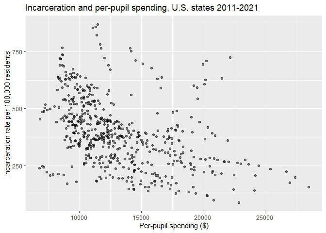
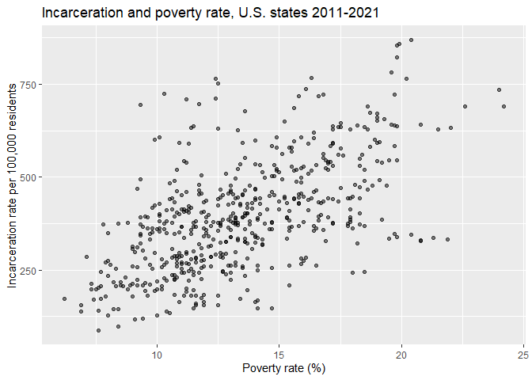

# Per Pupil Spending and Incarceration Rates Across U.S. States
Logan Utter

## Introduction

This document replicates in R an analysis originally conducted in Stata
as an undergraduate econometrics project at the University of
St. Thomas. The original project was coauthored with Moses Yazachew
under the supervision of Dr. Luz Saavedra. The coefficient estimates
match closely with the original Stata output. Standard errors differ
slightly because the Stata and R implementations of the Newey-West
estimator apply different small-sample corrections, but the conclusions
are unchanged. Where a diagnostic test has no exact R equivalent, the
substitution is noted in the text.

The analysis examines the relationship between public education funding
and incarceration across U.S. states. The hypothesis is that states
spending more per pupil have lower incarceration rates, on the reasoning
that better-funded schools improve access to legitimate economic
opportunity and reduce the appeal of criminal activity. The model
estimates this relationship using panel data on all 50 states from 2011
through 2021, controlling for economic, demographic, political, and law
enforcement factors.

## Literature Review

Four papers informed the specification below. Full citations are listed
in the Literature Cited section.

Jacobs and Helms (1996) identify family structure as the strongest
predictor of prison admission rates, using out-of-wedlock births as
their measure of family breakdown. The share of children living in
single-parent households is included here for the same reason. They also
find that the occurrence of a presidential election and the strength of
the Republican party are linked to higher incarceration, motivating the
two political indicators in this model: governor party affiliation and
presidential election year.

Sutton and Routon (2023) examine the effects of poverty and inequality,
finding poverty significant across multiple specifications and samples.
Poverty rate is included here on that basis, alongside median household
income as a standard control for state economic conditions. The authors
measure inequality using the Gini index, which is adopted for this
analysis as well. Gini index captures the full income distribution in a
single figure and is reported consistently across states and years,
making it a convenient choice for analysis.

Broyles (2020) goes into detail on education related variables and their
relationship with crime and incarceration. The results show that
additional schooling reduces the probability of incarceration and that
higher per-pupil spending is associated with reduced theft and lower
crime-related costs. This work solidified the evidence of a relationship
between per-pupil spending and incarceration, and also prompted the
inclusion of high school graduation rate. Graduation rate serves as a
check on whether spending translates into educational attainment, since
funding increases that do not raise graduation rates may not produce the
same effect on incarceration.

Kaplan and Chalfin (2019) examine law enforcement staffing, concluding
that a larger police presence deters offenders and reduces
incarceration, though the wider literature is mixed. Law enforcement
officers per 100,000 residents is included here, matching the units of
the dependent variable.

## Data

This analysis uses panel data covering all 50 U.S. states from 2011
through 2021, giving 550 state-year observations. The dependent variable
is the incarceration rate per 100,000 residents, drawn from the Bureau
of Justice Statistics. Independent variables come from the National
Center for Education Statistics (per-pupil spending, high school
graduation rates), FRED (median household income), the Census Bureau
(poverty rate, Gini coefficient), the FBI UCR program (law enforcement
officers), the Kids Count Data Center (single-parent households), and
the National Governors Association (governor party).

``` r
d <- read.csv("data/incarceration data.csv")
```

The raw CSV contains blank rows and two empty columns picked up from the
original Excel spreadsheet. Both are removed before analysis.

``` r
d <- d[!is.na(d$Year), ]
d$X <- NULL
d$X.1 <- NULL
```

Median household income and per-pupil spending are stored as text in the
raw file because their values contain commas. Both are converted to
numeric.

``` r
d$Median.Household.Income.... <- as.numeric(gsub("[ ,]", "", d$Median.Household.Income....))
d$Per.Pupil.Spending..... <- as.numeric(gsub("[ ,]", "", d$Per.Pupil.Spending.....))
```

The percentage-based variables (high school graduation rate, poverty
rate, single-parent households, and the Gini coefficient) are stored as
decimals but reported here as percentages, so each is multiplied by 100.
This makes the corresponding coefficients interpretable as the effect of
a one percentage point change.

``` r
d$High.School.Graduation.Rate.... <- d$High.School.Graduation.Rate.... * 100
d$Poverty.Rate.... <- d$Poverty.Rate.... * 100
d$Children.Living.in.Single.Parent.Households.... <- d$Children.Living.in.Single.Parent.Households.... * 100
d$Gini.Index <- d$Gini.Index * 100
```

R converts spaces and punctuation from the original headers into
periods, so column names are shortened for readability. Rows are sorted
by state and year.

``` r
names(d) <- c("year", "state", "incr", "hsg", "mhi", "gp",
              "pr", "pps", "sph", "pey", "gc", "leo")
d <- d[order(d$state, d$year), ]
str(d)
```

    'data.frame':   550 obs. of  12 variables:
     $ year : int  2011 2012 2013 2014 2015 2016 2017 2018 2019 2020 ...
     $ state: chr  "Alabama" "Alabama" "Alabama" "Alabama" ...
     $ incr : int  651 660 672 655 634 584 545 551 579 517 ...
     $ hsg  : num  72 75 80 86 89 92 89 90 92 91 ...
     $ mhi  : num  55940 56010 60250 53070 55920 ...
     $ gp   : int  1 1 1 1 1 1 1 1 1 1 ...
     $ pr   : num  19 19 18.7 19.3 18.5 17.1 16.9 16.8 15.5 14.9 ...
     $ pps  : num  9296 8927 9486 9543 9690 ...
     $ sph  : num  39 39 41 40 40 39 39 39 40 38 ...
     $ pey  : int  0 1 0 0 0 1 0 0 0 1 ...
     $ gc   : num  47.3 47.3 47.5 47.6 48.1 ...
     $ leo  : int  363 336 333 337 399 321 338 333 386 370 ...

### Summary Statistics

Before estimating the model, the distribution of each variable and its
bivariate relationship with the incarceration rate are examined.

``` r
summary(d[, 3:12])
```

          incr            hsg             mhi               gp        
     Min.   : 88.0   Min.   :62.00   Min.   : 41170   Min.   :0.0000  
     1st Qu.:282.2   1st Qu.:80.00   1st Qu.: 63880   1st Qu.:0.0000  
     Median :378.5   Median :84.00   Median : 72285   Median :1.0000  
     Mean   :393.7   Mean   :83.53   Mean   : 73465   Mean   :0.6018  
     3rd Qu.:475.0   3rd Qu.:88.00   3rd Qu.: 82773   3rd Qu.:1.0000  
     Max.   :868.0   Max.   :93.00   Max.   :113000   Max.   :1.0000  
           pr             pps             sph             pey        
     Min.   : 6.20   Min.   : 6787   Min.   :18.00   Min.   :0.0000  
     1st Qu.:11.00   1st Qu.:10278   1st Qu.:30.00   1st Qu.:0.0000  
     Median :13.05   Median :12235   Median :34.00   Median :0.0000  
     Mean   :13.45   Mean   :13174   Mean   :33.84   Mean   :0.2727  
     3rd Qu.:15.88   3rd Qu.:15368   3rd Qu.:37.00   3rd Qu.:1.0000  
     Max.   :24.20   Max.   :28535   Max.   :49.00   Max.   :1.0000  
           gc             leo       
     Min.   :40.81   Min.   :196.0  
     1st Qu.:44.99   1st Qu.:270.0  
     Median :46.41   Median :316.0  
     Mean   :46.33   Mean   :320.3  
     3rd Qu.:47.76   3rd Qu.:350.8  
     Max.   :51.57   Max.   :746.0  

Pairwise correlations between the incarceration rate and each
independent variable show the direction and strength of each
relationship before controlling for other factors.

``` r
round(cor(d$incr, d[, 4:12]), 4)
```

             hsg     mhi     gp     pr     pps    sph     pey     gc    leo
    [1,] -0.2652 -0.5106 0.1656 0.5918 -0.4314 0.5393 -0.0544 0.1443 0.2201

The scatter plot of incarceration rate against per-pupil spending helps
illustrate the bivariate relationship between the dependent variable and
main variable of interest.

``` r
ggplot(d, aes(x = pps, y = incr)) +
geom_point(alpha = 0.5) +
labs(
  x = "Per-pupil spending ($)",
  y = "Incarceration rate per 100,000 residents",
  title = "Incarceration and per-pupil spending, U.S. states 2011-2021"
)
```



Poverty rate had the highest correlation coefficient among the
independent variables. This bivariate relationship can be observed in
the scatter plot below.

``` r
ggplot(d, aes(x = pr, y = incr)) +
geom_point(alpha = 0.5) +
labs(
  x = "Poverty rate (%)",
  y = "Incarceration rate per 100,000 residents",
  title = "Incarceration and poverty rate, U.S. states 2011-2021"
)
```



## Model

The model estimates the relationship between per-pupil spending and the
incarceration rate, controlling for educational, economic, political,
and law enforcement factors that vary across states and over time.
Per-pupil spending and median household income are expressed in
logarithmic form, allowing the coefficients to be interpreted in terms
of proportional changes rather than dollars.

$$INCR_{it} = \beta_0 + \beta_1 HSG_{it} + \beta_2 \ln(MHI_{it}) + \beta_3 GP_{it} + \beta_4 PR_{it} + \beta_5 \ln(PPS_{it}) + \beta_6 SPH_{it} + \beta_7 PEY_{it} + \beta_8 GC_{it} + \beta_9 LEO_{it} + \varepsilon_{it}$$

where *i* indexes states and *t* indexes years.

| Variable | Description                                    |
|----------|------------------------------------------------|
| INCR     | Incarceration rate per 100,000 residents       |
| HSG      | High school graduation rate (%)                |
| MHI      | Median household income (\$)                   |
| GP       | Governor party (Republican = 1, other = 0)     |
| PR       | Poverty rate (%)                               |
| PPS      | Per-pupil spending (\$)                        |
| SPH      | Children in single-parent households (%)       |
| PEY      | Presidential election year (yes = 1, no = 0)   |
| GC       | Gini index (0 to 100)                          |
| LEO      | Law enforcement officers per 100,000 residents |

``` r
m <- lm(incr ~ hsg + log(mhi) + gp + pr + log(pps) + sph + pey + gc + leo, data = d)
summary(m)
```

    Call:
    lm(formula = incr ~ hsg + log(mhi) + gp + pr + log(pps) + sph + 
        pey + gc + leo, data = d)

    Residuals:
        Min      1Q  Median      3Q     Max 
    -283.11  -72.22   -8.99   57.87  376.05 

    Coefficients:
                  Estimate Std. Error t value Pr(>|t|)    
    (Intercept)  436.57493  710.13531   0.615   0.5390    
    hsg            0.86539    0.99644   0.868   0.3855    
    log(mhi)     121.97042   58.29998   2.092   0.0369 *  
    gp             0.38400   10.21810   0.038   0.9700    
    pr            15.94890    3.92543   4.063 5.56e-05 ***
    log(pps)    -132.08391   23.69658  -5.574 3.94e-08 ***
    sph           12.51879    1.47810   8.470 2.34e-16 ***
    pey          -16.11366   10.39064  -1.551   0.1215    
    gc           -21.37207    3.45355  -6.188 1.20e-09 ***
    leo            0.38703    0.07892   4.904 1.24e-06 ***
    ---
    Signif. codes:  0 '***' 0.001 '**' 0.01 '*' 0.05 '.' 0.1 ' ' 1

    Residual standard error: 107.9 on 540 degrees of freedom
    Multiple R-squared:  0.4777,    Adjusted R-squared:  0.469 
    F-statistic: 54.87 on 9 and 540 DF,  p-value: < 2.2e-16

## Diagnostics

Four diagnostic tests are run to check for potential issues with the
model.

First, the Ramsey RESET test checks for model misspecification and
omitted variable bias. A significant result would suggest the model
omits relevant nonlinear terms or variables. The test returns an
F-statistic of 2.0114, with a p-value of 0.1113, so the null hypothesis
of correct specification cannot be rejected.

``` r
resettest(m, power = 2:4)
```

        RESET test

    data:  m
    RESET = 2.0114, df1 = 3, df2 = 537, p-value = 0.1113

Next, the Breusch-Pagan test examines whether the variance of the
residuals depends on the explanatory variables. The results of this test
show a Breusch-Pagan statistic of 57.7 (p\<0.001), leading to rejection
of the null hypothesis of homoscedasticity. This gives strong evidence
that the model does not have constant residual variance, so the default
standard errors are not valid for inference. The original analysis used
White’s test in Stata. The Breusch-Pagan test used here examines the
same null hypothesis and reaches the same conclusion.

``` r
bptest(m)
```

        studentized Breusch-Pagan test

    data:  m
    BP = 57.704, df = 9, p-value = 3.703e-09

The variance inflation factor (VIF) assesses the presence of
multicollinearity in the model. The mean VIF is 2.77, which is well
below the conventional threshold of 10, and no individual variable
exceeds it. This means multicollinearity does not appear to distort the
estimated coefficients. The two highest values belong to poverty rate
(8.14) and median household income (5.01), which is expected given that
the two measure overlapping aspects of state economic conditions.

``` r
vif(m)
```

         hsg log(mhi)       gp       pr log(pps)      sph      pey       gc 
    1.345401 5.011278 1.182649 8.138222 2.076481 2.763259 1.012229 2.083169 
         leo 
    1.312361 

``` r
mean(vif(m))
```

    [1] 2.76945

The Wooldridge test for serial correlation tests whether the residuals
for a given state are correlated across years. Since the data are panel
rather than a single time series, the test accounts for the state
grouping. The test returns an F-statistic of 26.02 (p \< 0.001),
rejecting the null of no first-order serial correlation. Residuals
within a state are correlated across years, which means the default
standard errors are too small. The R implementation is Wooldridge’s test
as applied to fixed-effects panels, which differs slightly from the
Stata command used originally, but tests the same null hypothesis.

``` r
pd <- pdata.frame(d, index = c("state", "year"))
pwartest(incr ~ hsg + log(mhi) + gp + pr + log(pps) + sph + pey + gc + leo, data = pd)
```

        Wooldridge's test for serial correlation in FE panels

    data:  plm.model
    F = 26.018, df1 = 1, df2 = 498, p-value = 4.818e-07
    alternative hypothesis: serial correlation

Since diagnostic testing indicated both heteroscedasticity and
autocorrelation in the residuals, Newey-West standard errors are used to
correct for both simultaneously. Because the F-statistic reported by the
standard regression output assumes homoscedastic and independent errors,
joint significance is tested here using the Newey-West standard errors
as well.

``` r
coeftest(m,vcov = NeweyWest(m, lag = 1, prewhite = FALSE))
```

    t test of coefficients:

                  Estimate Std. Error t value  Pr(>|t|)    
    (Intercept)  436.57493  880.54934  0.4958 0.6202384    
    hsg            0.86539    1.37690  0.6285 0.5299375    
    log(mhi)     121.97042   68.15453  1.7896 0.0740759 .  
    gp             0.38400   12.60352  0.0305 0.9757052    
    pr            15.94890    4.92473  3.2385 0.0012753 ** 
    log(pps)    -132.08391   36.00938 -3.6680 0.0002686 ***
    sph           12.51879    1.82438  6.8620 1.868e-11 ***
    pey          -16.11366    8.31695 -1.9374 0.0532116 .  
    gc           -21.37207    5.74898 -3.7175 0.0002222 ***
    leo            0.38703    0.11196  3.4568 0.0005897 ***
    ---
    Signif. codes:  0 '***' 0.001 '**' 0.01 '*' 0.05 '.' 0.1 ' ' 1

``` r
summary(m)$r.squared
```

    [1] 0.4776644

``` r
lmtest::waldtest(m, vcov = NeweyWest(m, lag = 1, prewhite = FALSE))
```

    Wald test

    Model 1: incr ~ hsg + log(mhi) + gp + pr + log(pps) + sph + pey + gc + 
        leo
    Model 2: incr ~ 1
      Res.Df Df      F    Pr(>F)    
    1    540                        
    2    549 -9 27.763 < 2.2e-16 ***
    ---
    Signif. codes:  0 '***' 0.001 '**' 0.01 '*' 0.05 '.' 0.1 ' ' 1

## Results

The coefficient on log per-pupil spending is -132.08, significant at the
1% level. This negative sign is consistent with the original hypothesis
that increased per-pupil spending coincides with lower incarceration
rates. Since this variable is in logged form, the coefficient implies
that a 1% increase in per-pupil spending is associated with roughly 1.32
fewer incarcerated individuals per 100,000. Putting this into
perspective, the sample mean for per-pupil spending is \$13,174, making
a 1% increase equivalent to \$132. If per-pupil spending was 10%, or
\$1,317 higher at the state level, the model predicts that the state
would have 12.6 fewer incarcerated individuals per 100,000. If this
hypothetical state had the sample mean incarceration rate of 393.7, this
estimated decrease of 12.6 individuals would be equivalent to a 3.4%
decrease in statewide incarceration.

One surprising result is the coefficient on the Gini index. The original
hypothesis, supported by the literature, was that states with higher
income inequality would have higher incarceration rates. The model
suggests the opposite, predicting that a 0.01 increase in the Gini index
corresponds with roughly 21 fewer incarcerated individuals per 100,000.
Not only is the negative sign unexpected, but the variable is
significant at the 1% level. One of the most convincing explanations for
this relationship is that it is not due to economic inequality itself,
but the policies put forth by states with higher Gini indices. It is
plausible that these states have more progressive prison policies
focused on post-incarceration support and shorter prison sentences,
which would decrease incarceration rates in those areas.

Another counterintuitive result is the positive coefficient on log
median household income, significant at the 10% level. While the idea
that states with higher incomes experience higher incarceration rates
contradicts economic intuition, there is a clearer explanation in this
case. As mentioned in the diagnostics section, the mean VIF is low at
2.77, but median household income and poverty rate stand well above the
other variables with values of 5.01 and 8.14 respectively. This is worth
noting, since when poverty rate is excluded from the model, the
coefficient for median household income turns negative as suspected, but
is not statistically significant. The positive income coefficient should
therefore be interpreted with caution.

The variables for poverty rate, single-parent households, and law
enforcement officers are all significant at the 1% level. The positive
signs on poverty and single-parent households are consistent with the
hypotheses drawn from the literature review. Conversely, graduation rate
and governor party are not statistically distinguishable from zero. The
presidential election year indicator is significant only at the 10%
level, and its negative sign runs against expectations. This variable
may be better specified for the year preceding an election, since the
political incentive to appear tough on crime is strongest during the
campaign rather than after it.

Among the significant results, law enforcement officers is the one
variable that shares units with the dependent variable, both measured
per 100,000 residents, making the coefficient directly comparable. The
most helpful interpretation of this coefficient is that roughly three
additional officers per 100,000 residents corresponds to one additional
incarcerated individual per 100,000. This runs against Kaplan and
Chalfin (2019), who find that additional officers reduce incarceration
through deterrence. The positive sign here suggests enforcement capacity
is the dominating effect.

The overall fit of the regression model is relatively strong, shown by
the R-squared value of 0.4777. This indicates that about 48% of the
variation in incarceration rates is explained by the included variables,
which is reasonable for cross-state social data where much of the
variation reflects unmeasured institutional differences. The Wald test
returns an F-statistic of 27.76 (p \< 0.001), providing strong evidence
against the null that the nine coefficients are jointly zero.

## Conclusion

The original hypothesis was that higher per-pupil spending would be
associated with lower incarceration rates, and the estimates support
this. Per-pupil spending is significant at the 1% level, and the
magnitude is meaningful at a policy-relevant scale, with a 10% increase
in spending at the sample mean corresponding to about 12.6 fewer
incarcerated individuals per 100,000 residents.

Education funding is the main variable of interest, but it is not the
largest factor at work. Poverty rate and the share of children in
single-parent households both carry larger effects and are estimated
more precisely. This does not diminish the case for education funding,
but it suggests that spending increases work best alongside policies
addressing economic hardship and family stability rather than in
isolation.

Several limitations bound what these estimates can support. The
eleven-year window is short for variables whose effects accumulate
slowly, including governor party and law enforcement staffing, where
policy changes may take years to appear in incarceration counts.
Reporting at the state level also obscures substantial variation within
states, which matters here because school funding and law enforcement
practice are largely determined at the municipal level. For this reason,
county-level data would allow a more precise estimate. Finally, the
model is estimated by pooled OLS without state fixed effects, so the
coefficients compare states to one another rather than tracking changes
within a single state over time. Permanent differences in state
institutions, sentencing policy, and history are absorbed into the
estimates rather than controlled for. Because of this, adding state
fixed effects is the natural next step.

## Literature Cited

Jacobs, D., & Helms, R. E. (1996). Toward a Political Model of
Incarceration: A Time-Series Examination of Multiple Explanations for
Prison Admission Rates. American Journal of Sociology, 102(2), 323–357.
https://doi.org/10.1086/230949

Sutton, M., & P. Wesley Routon. (2023). Poverty, Inequality, and
Incarceration: Estimates from State- and Prison-Level Data. Journal of
Poverty, 1–18. https://doi.org/10.1080/10875549.2023.2235336

Broyles, T. (2020). Can Better Classrooms Lead to Empty Cells? \[Review
of Can Better Classrooms Lead to Empty Cells? Young Scholar Awards
Program 2019–20.
https://faithandpubliclife.com/wp-content/uploads/2021/02/Broyles_FINAL.pdf

Kaplan, J., & Chalfin, A. (2019). More cops, fewer prisoners?
Criminology & Public Policy, 18(1), 171–200.
https://policingresearch.org/wp-content/uploads/2022/01/More-cops-fewer-prisoners.pdf
